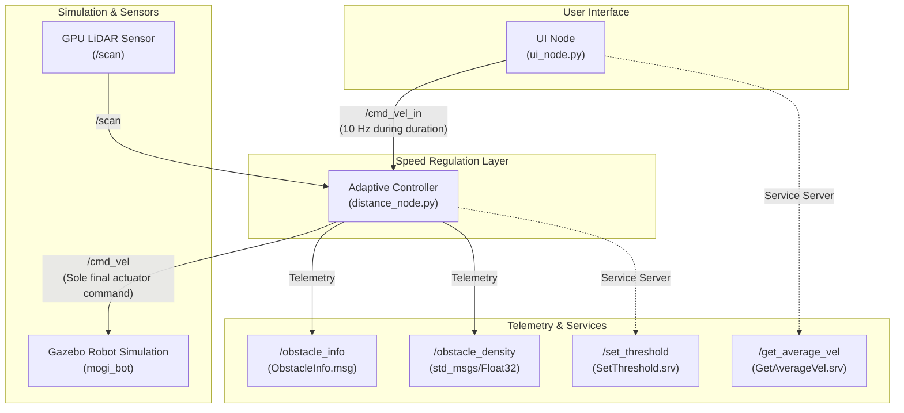

<div align="center">

# Adaptive Speed Control in Cluttered Environments
### ROS 2 & Gazebo Mobile Robot Safety and Velocity Regulation

**A dynamic, reactive velocity regulation architecture for teleoperated mobile robots using 2D LiDAR point clouds, surrounding obstacle density estimation, and runtime parameter configuration.**

<p>
  
  
  
  
  
</p>

</div>

---

## 1. Project Overview & Problem Statement

In autonomous mobile robotics and remote teleoperation, fixed-speed command execution in uncertain, dynamic, or cluttered environments poses severe safety risks. Operating at constant nominal velocities inside tight spaces frequently results in collisions due to operator latency, sensor delays, and physical braking inertia. Conversely, forcing the robot to operate at a permanent crawling speed cripples transport efficiency in open spaces.

This project delivers an **Adaptive Speed Controller** implemented for ROS 2 (Jazzy) and Gazebo Harmonic. The system dynamically modulates the robot's translational velocity based on:
1. **Obstacle Proximity:** The real-time Euclidean distance to obstacles within the forward collision cone.
2. **Obstacle Density:** The spatial concentration (clutter) of obstacles within a configurable surrounding radius.
3. **Safety Critical Halting:** Instantaneous emergency stop upon obstacle encroachment within the safety threshold ($d_{safe} \le 0.45\text{ m}$).
4. **Sensor and Command Fail-Safe:** Deterministic zero-velocity enforcement if sensor data or operator commands become stale.

---

## 2. System Architecture

The software architecture enforces strict decoupling between the user interface and the simulation actuator layer:



### Architectural Highlights
- **Single Master Publisher:** `distance_node` is the **only** publisher of final `/cmd_vel` messages to Gazebo, avoiding conflicting or competing drive commands.
- **Input Forwarding:** `ui_node` publishes requested teleop velocities to `/cmd_vel_in` at 10 Hz for the duration specified by the user, followed by an explicit zero-velocity command upon expiration.
- **Bi-directional Telemetry:** Telemetry topics (`/obstacle_info`, `/obstacle_density`) and runtime services (`/set_threshold`, `/get_average_vel`) allow live external monitoring and dynamic threshold reconfiguration.

---

## 3. Adaptive Speed Control Algorithm

### Mathematical Formulation

Let the user-requested velocity command be denoted as:
$$\mathbf{u}_{req} = \begin{bmatrix} v_{req} \\ \omega_{req} \end{bmatrix}$$

First, inputs are bounded by system safety maximums:
$$v_{target} = \min(v_{req}, v_{max}) \quad \text{where } v_{max} = 0.40\text{ m/s}$$
$$\omega_{target} = \text{sign}(\omega_{req}) \cdot \min(|\omega_{req}|, \omega_{max}) \quad \text{where } \omega_{max} = 1.00\text{ rad/s}$$

#### 1. Forward Sector LiDAR Filtering
Given raw scan ranges $\{r_i\}$ and beam angles $\{\theta_i\}$ from `sensor_msgs/msg/LaserScan`:
- Invalids are discarded: $r_i \in [r_{min}, r_{max}]$ and finite.
- Forward collision cone: $|\theta_i| \le \theta_{front}$ (where default $\theta_{front} = 60^\circ$).
- Minimum forward distance:
$$d_{front} = \min \left( \{r_i \mid |\theta_i| \le \theta_{front}\} \cup \{\infty\} \right)$$

#### 2. Obstacle Proximity Scaling ($S_{dist}$)
Let $d_{safe} = 0.45\text{ m}$ (safety threshold) and $d_{slow} = 1.50\text{ m}$ (slowdown distance).
$$S_{dist} = \begin{cases}
0.0 & \text{if } d_{front} \le d_{safe} \quad (\text{EMERGENCY\_STOP}) \\
\dfrac{d_{front} - d_{safe}}{d_{slow} - d_{safe}} & \text{if } d_{safe} < d_{front} < d_{slow} \quad (\text{SLOWDOWN\_DISTANCE}) \\
1.0 & \text{if } d_{front} \ge d_{slow} \quad (\text{CLEAR\_SPEED\_OK})
\end{cases}$$

#### 3. Obstacle Density Calculation ($\rho$) & Clutter Factor ($S_{dens}$)
The obstacle density $\rho \in [0.0, 1.0]$ represents the proportion of valid LiDAR beams in the monitoring sector that detect an obstacle within the clutter radius $R_{dens} = 1.20\text{ m}$:
$$\rho = \frac{\sum \mathbf{1}_{\{r_i \le R_{dens}\}}}{N_{total}}$$
With density weighting factor $\alpha \in [0.0, 1.0]$ (default $\alpha = 0.50$):
$$S_{dens} = 1.0 - (\alpha \cdot \rho)$$

#### 4. Combined Commanded Velocity ($v_{cmd}$)
$$S_{total} = \max(0.0, \min(1.0, S_{dist} \cdot S_{dens}))$$
$$v_{cmd} = v_{target} \cdot S_{total}$$

#### 5. Safety States & Emergency Action
$$\begin{array}{|l|l|l|}
\hline
\textbf{State} & \textbf{Condition} & \textbf{Controller Action} \\
\hline
\text{CLEAR\_SPEED\_OK} & d_{front} \ge 1.50\text{ m}, \rho \le 0.20 & v_{cmd} \approx v_{req} \\
\text{SLOWDOWN\_DISTANCE} & 0.45\text{ m} < d_{front} < 1.50\text{ m} & \text{Gradual, smooth linear deceleration} \\
\text{SLOWDOWN\_CLUTTER} & d_{front} \ge 1.50\text{ m}, \rho > 0.20 & \text{Speed reduced up to } (1 - \alpha) \cdot v_{target} \\
\text{EMERGENCY\_STOP} & d_{front} \le 0.45\text{ m} & v_{cmd} = 0.0\text{ m/s}, \omega_{cmd} = 0.0\text{ rad/s} \\
\text{SENSOR\_TIMEOUT} & t_{now} - t_{scan} > 0.50\text{ s} & v_{cmd} = 0.0\text{ m/s (Fail-safe Halt)} \\
\text{IDLE} & t_{now} - t_{cmd} > 0.50\text{ s} & v_{cmd} = 0.0\text{ m/s} \\
\hline
\end{array}$$

---

## 4. ROS 2 Topics, Services, and Parameters

### Active Topics
| Topic | Message Type | Direction | Description |
| --- | --- | --- | --- |
| `/scan` | `sensor_msgs/msg/LaserScan` | Gazebo $\to$ Controller | 360-degree raw planar laser scan |
| `/cmd_vel_in` | `geometry_msgs/msg/Twist` | UI $\to$ Controller | Raw user velocity commands |
| `/cmd_vel` | `geometry_msgs/msg/Twist` | Controller $\to$ Gazebo | Sole safe commanded robot velocities |
| `/obstacle_info` | `rt1_assignment2_interfaces/msg/ObstacleInfo` | Controller $\to$ Network | Closest distance, direction, active threshold |
| `/obstacle_density` | `std_msgs/msg/Float32` | Controller $\to$ Network | Calculated clutter density $\rho \in [0, 1]$ |

### Custom Message: `ObstacleInfo.msg`
```text
float32 closest_distance    # Distance to closest point in scan (meters)
string direction            # Direction sector: "front", "left", "right", "behind"
float32 threshold           # Current active safety threshold (meters)
```

### Services
| Service | Service Type | Server Node | Description |
| --- | --- | --- | --- |
| `/set_threshold` | `rt1_assignment2_interfaces/srv/SetThreshold` | `distance_node` | Dynamically updates $d_{safe}$ (validates $0 < d_{safe} < d_{slow}$) |
| `/get_average_vel` | `rt1_assignment2_interfaces/srv/GetAverageVel` | `ui_node` | Returns average linear/angular velocity of last 5 commands |

### ROS 2 Configurable Parameters (`distance_node`)
| Parameter | Default | Range | Description |
| --- | --- | --- | --- |
| `threshold` | `0.45` | $(0.0, d_{slow})$ | Emergency stopping distance (m) |
| `slowdown_distance` | `1.50` | $(d_{safe}, 10.0)$ | Distance where speed reduction begins (m) |
| `density_radius` | `1.20` | $(0.0, 5.0)$ | Surrounding radius for clutter estimation (m) |
| `density_influence` | `0.50` | $[0.0, 1.0]$ | Weighting factor $\alpha$ for density slowdown |
| `max_linear_speed` | `0.40` | $(0.0, 2.0)$ | Maximum allowable linear velocity (m/s) |
| `max_angular_speed` | `1.00` | $(0.0, 3.0)$ | Maximum allowable angular velocity (rad/s) |
| `front_angle_deg` | `60.0` | $(0.0, 180.0)$ | Half-angle of forward collision cone (deg) |
| `sensor_timeout` | `0.50` | $(0.0, 5.0)$ | Max scan latency before safe halt (s) |
| `cmd_timeout` | `0.50` | $(0.0, 5.0)$ | Max command latency before idle stop (s) |
| `control_rate` | `20.0` | $(1.0, 100.0)$ | Control loop frequency (Hz) |

---

## 5. Build & Installation Instructions

### Prerequisites
- Ubuntu 24.04 LTS
- ROS 2 Jazzy Jalisco
- Gazebo Harmonic (gz-sim)
- `python3-colcon-common-extensions`, `python3-pytest`

### Step-by-Step Compilation
```bash
# 1. Source ROS 2 Jazzy
source /opt/ros/jazzy/setup.bash

# 2. Navigate to repository root
cd ~/ros2-lidar-safety-controller

# 3. Build all workspace packages
colcon build --symlink-install

# 4. Source local workspace
source install/setup.bash
```

### Running Automated Test Suite
The package includes 13 automated unit and integration tests covering mathematical speed scaling, density weighting, emergency stops, parameter validation, and timeout handling:
```bash
colcon test --packages-select rt1_assignment2 && colcon test-result --verbose
```
Expected output:
```text
Summary: 13 tests, 0 errors, 0 failures, 0 skipped
```

---

## 6. Demonstration Sequence for Presentation & Viva

The simulation includes three pre-configured static scenarios in `my.sdf`.

### Terminal Setup (3 Separate Terminals)

In all terminals, first source the environments:
```bash
source /opt/ros/jazzy/setup.bash
cd ~/vikash/ros2-lidar-safety-controller
source install/setup.bash
```

---

### Scenario 1: Open Environment (Free Trajectory)
**Objective:** Verify that in an unobstructed corridor, the robot moves at full requested speed ($S_{total} = 100\%$) with zero density.

**Terminal 1 (Gazebo):**
```bash
ros2 launch bme_gazebo_sensors spawn_robot.launch.py scenario:=1
```
*(Robot spawns at $x=0.0, y=0.0, \text{yaw}=0.0$ facing an open corridor).*

**Terminal 2 (Controller):**
```bash
ros2 run rt1_assignment2 distance_node
```

**Terminal 3 (UI):**
```bash
ros2 run rt1_assignment2 ui_node
```
Enter command:
```text
0.30 0.0 5.0
```

**Measured Output in Controller Terminal:**
```text
[INFO] [distance_node]: [STATUS] State: CLEAR_SPEED_OK    | Front: 2.05m | Closest: 2.05m (right) | Density: 0.00 | Req Lin: 0.30 m/s | Cmd Lin: 0.30 m/s | Scale: 100.0%
```

---

### Scenario 2: Moderately Cluttered Environment (Single Pillar Slowdown)
**Objective:** Demonstrate smooth, continuous deceleration as the robot approaches a single static obstacle.

**Terminal 1 (Gazebo):**
```bash
ros2 launch bme_gazebo_sensors spawn_robot.launch.py scenario:=2
```
*(Robot spawns at $x=0.0, y=6.0, \text{yaw}=0.0$ directly facing a blue pillar at $x=2.5$).*

**Terminal 2 & 3:** Run `distance_node` and `ui_node`.  
Enter command in UI:
```text
0.30 0.0 8.0
```

**Measured Progression in Controller Terminal:**
```text
[INFO] [distance_node]: [STATUS] State: CLEAR_SPEED_OK    | Front: 2.15m | Closest: 2.15m (front) | Density: 0.00 | Req Lin: 0.30 m/s | Cmd Lin: 0.30 m/s | Scale: 100.0%
[INFO] [distance_node]: [STATUS] State: SLOWDOWN_DISTANCE | Front: 1.30m | Closest: 1.30m (front) | Density: 0.12 | Req Lin: 0.30 m/s | Cmd Lin: 0.23 m/s | Scale: 76.2%
[INFO] [distance_node]: [STATUS] State: SLOWDOWN_DISTANCE | Front: 0.95m | Closest: 0.95m (front) | Density: 0.18 | Req Lin: 0.30 m/s | Cmd Lin: 0.13 m/s | Scale: 43.3%
[INFO] [distance_node]: [STATUS] State: SLOWDOWN_DISTANCE | Front: 0.65m | Closest: 0.65m (front) | Density: 0.21 | Req Lin: 0.30 m/s | Cmd Lin: 0.05 m/s | Scale: 17.1%
```

---

### Scenario 3: Highly Cluttered Alley & Emergency Stop
**Objective:** Demonstrate high density detection ($\rho > 0.60$) and immediate emergency halt when an obstacle enters $d \le 0.45\text{ m}$.

**Terminal 1 (Gazebo):**
```bash
ros2 launch bme_gazebo_sensors spawn_robot.launch.py scenario:=3
```
*(Robot spawns at $x=0.0, y=-4.0, \text{yaw}=0.0$ in front of a dense obstacle corridor ending in a barrier).*

**Terminal 2 & 3:** Run `distance_node` and `ui_node`.  
Enter command in UI:
```text
0.35 0.0 8.0
```

**Measured Progression in Controller Terminal:**
```text
[INFO] [distance_node]: [STATUS] State: SLOWDOWN_DISTANCE | Front: 1.27m | Closest: 1.27m (front) | Density: 0.00 | Req Lin: 0.35 m/s | Cmd Lin: 0.27 m/s | Scale: 77.7%
[INFO] [distance_node]: [STATUS] State: SLOWDOWN_DISTANCE | Front: 1.10m | Closest: 1.10m (front) | Density: 0.37 | Req Lin: 0.35 m/s | Cmd Lin: 0.18 m/s | Scale: 50.7%
[INFO] [distance_node]: [STATUS] State: SLOWDOWN_DISTANCE | Front: 0.96m | Closest: 0.96m (front) | Density: 0.51 | Req Lin: 0.35 m/s | Cmd Lin: 0.13 m/s | Scale: 36.5%
[INFO] [distance_node]: [STATUS] State: SLOWDOWN_DISTANCE | Front: 0.72m | Closest: 0.72m (front) | Density: 0.62 | Req Lin: 0.35 m/s | Cmd Lin: 0.06 m/s | Scale: 17.8%
[WARN] [distance_node]: [STATUS] State: EMERGENCY_STOP    | Front Dist: 0.43 m <= 0.45 m | Density: 0.71 | Robot STOPPED
```

---

### Reconfiguring Parameters at Runtime

#### Service Call `/set_threshold`:
```bash
ros2 service call /set_threshold rt1_assignment2_interfaces/srv/SetThreshold "{threshold: 0.60}"
```
Response:
```text
response: rt1_assignment2_interfaces.srv.SetThreshold_Response(success=True, message='Safety threshold updated successfully to 0.600 m.')
```

#### Querying Recent Command Averages `/get_average_vel`:
```bash
ros2 service call /get_average_vel rt1_assignment2_interfaces/srv/GetAverageVel "{}"
```
Response:
```text
response: rt1_assignment2_interfaces.srv.GetAverageVel_Response(avg_linear=0.30, avg_angular=0.0, samples=3)
```

#### Dynamic Parameter Update:
```bash
ros2 param set /distance_node density_influence 0.75
```

---

## 7. Scope & System Limitations

> [!NOTE]
> This system is an **adaptive velocity regulator and reactive safety layer**, not an autonomous navigation or global path-planning stack (such as Nav2).
> - **Reactive:** It dynamically modulates forward and rotational speed according to immediate sensory measurements. It does not compute global $A^*$ paths, perform loop closure, or solve simultaneous localization and mapping (SLAM).
> - **2D Planar Assumption:** The LiDAR scan evaluates horizontal planar obstacles at the sensor mount height ($0.15\text{ m}$). Overhanging obstacles outside the scan plane require 3D depth cameras or 3D LiDAR.

---

## 8. Viva Voce & Presentation Defense Questions

**Q1: Why separate `/cmd_vel_in` from `/cmd_vel`?**  
*Answer:* In the original codebase, both `ui_node` and `distance_node` published directly to `/cmd_vel`, causing race conditions and conflicting motor commands. By separating the user command topic (`/cmd_vel_in`) from the actuator topic (`/cmd_vel`), the adaptive controller acts as the sole authoritative arbiter of robot motion.

**Q2: How is obstacle density calculated, and why is it useful?**  
*Answer:* Obstacle density $\rho$ is computed as the ratio of valid laser beams measuring an obstacle within radius $R_{dens} = 1.20\text{ m}$ over the total valid beams in the monitoring sector: $\rho = N_{close} / N_{total} \in [0, 1]$. While pure obstacle distance only measures the closest point, density captures spatial clutter. In narrow or crowded corridors, high density proactively suppresses velocity before the robot enters critical proximity.

**Q3: What happens if LiDAR sensor messages stop arriving?**  
*Answer:* The controller implements a deterministic fail-safe check in its 20 Hz control loop. If `time.time() - last_scan_time > sensor_timeout` (0.50 s), the controller immediately transitions to `SENSOR_TIMEOUT` and publishes zero velocity to halt the robot safely.

**Q4: How does the `/set_threshold` service validate input?**  
*Answer:* The service handler verifies that the requested threshold is a positive, finite number and is strictly less than the configured `slowdown_distance`. Reconfiguration requests violating these bounds are rejected with informative error messages.

**Q5: How does the UI node handle timed execution?**  
*Answer:* The UI node uses an internal 10 Hz timer callback that continuously streams the requested velocity to `/cmd_vel_in` for the user-specified duration. Upon timeout, it transmits an explicit zero `Twist` to stop the robot without blocking the ROS 2 executor.

---

## 9. Summary of Repository Modifications

| File | Change Nature | Justification |
| --- | --- | --- |
| `src/rt1_assignment2/rt1_assignment2/distance_node.py` | Complete Architecture Upgrade | Implemented adaptive speed calculation, obstacle density estimation, `/cmd_vel_in` subscriber, fail-safe timeouts, dynamic parameter callbacks, and clean throttling logs. |
| `src/rt1_assignment2/rt1_assignment2/ui_node.py` | Functional Enhancement | Redirected publication to `/cmd_vel_in`, implemented 10 Hz continuous timed streaming, robust input validation, and preserved `/get_average_vel` service. |
| `src/rt1_assignment2/package.xml` | Dependencies Updated | Added `std_msgs` and `pytest` test dependencies. |
| `src/rt1_assignment2/setup.py` | Package Config Updated | Registered test dependencies and launch file installation paths. |
| `src/rt1_assignment2/launch/adaptive_speed_control.launch.py` | Added Launch File | Provides unified launch capabilities with configurable runtime arguments. |
| `src/rt1_assignment2/test/test_adaptive_speed.py` | Automated Unit Tests | 10 unit tests verifying mathematical functions, bounds, density scaling, and emergency stop. |
| `src/rt1_assignment2/test/test_node_integration.py` | ROS 2 Integration Tests | 3 live node tests verifying service calls, rolling history, and scan-to-stop safety pipelines. |
| `src/bme_gazebo_sensors/worlds/my.sdf` | World Scenario Enhancement | Added static, colorful demonstration obstacles for Scenario 2 (pillar) and Scenario 3 (cluttered alley & barrier). |
| `src/bme_gazebo_sensors/launch/spawn_robot.launch.py` | Launch Enhancement | Added `scenario` preset argument (1: open, 2: moderate, 3: cluttered) for instant demonstration setup. |

---

## Author
**Endri Gjinaj**  
MSc Robotics Engineering  
University of Genoa
