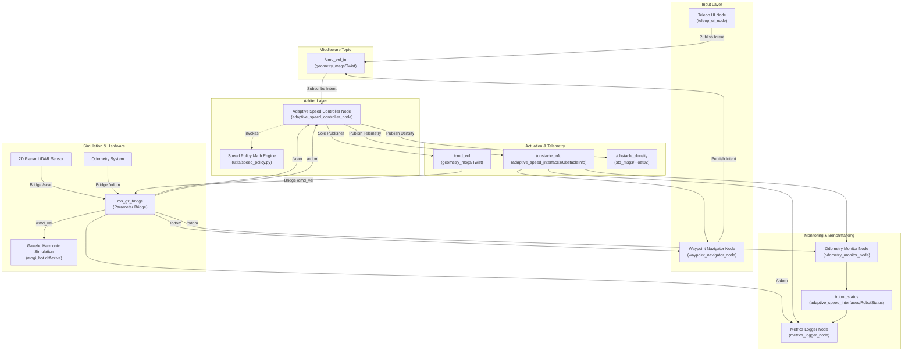

# System Architecture Specification

## 1. Architectural Philosophy and Design Principles

The **LidarX** system is engineered around four core safety invariants:

1. **Velocity Command Arbiter Pattern:**  
   The `adaptive_speed_controller_node` acts as the single authoritative gatekeeper and exclusive publisher of actuation commands to the physical or simulated robot chassis (`/cmd_vel`). Upstream controllers, planners, and human teleoperators communicate their desired intent exclusively through an intermediary topic (`/cmd_vel_in`). This eliminates race conditions, topic collision, and conflicting actuation commands.

2. **Decoupled Perception and Mathematical Purity:**  
   LiDAR point cloud filtering, multi-sector geometric extraction, and mathematical velocity attenuation are implemented as pure, stateless Python functions in `adaptive_speed_control.utils.speed_policy`. This decoupling enables microsecond-level unit test verification without spinning ROS graphs.

3. **Deterministic Fail-Safe Fallbacks:**  
   If either sensor measurements (`/scan`) or upstream control commands (`/cmd_vel_in`) become stale beyond their respective watchdog timeouts (default: 0.50 s), the controller immediately clamps commanded velocities to zero ($0.0\text{ m/s}$) and enters fail-safe modes (`SENSOR_TIMEOUT` or `IDLE`).

4. **Continuous Hysteresis-Governed State Transitions:**  
   Zone transitions and recovery from controlled emergency stops incorporate spatial buffers ($\Delta d = +0.20\text{ m}$) and density thresholds to prevent actuator chattering, oscillatory deceleration, and limit-cycle hunting.

---

## 2. ROS 2 Computation Graph

---

## 3. Communication Protocols and Topic Specifications

| Topic Name | Message Type | Direction | Publishing Rate | Functional Description |
| :--- | :--- | :--- | :--- | :--- |
| `/cmd_vel_in` | `geometry_msgs/msg/Twist` | UI / Nav $\to$ Controller | 10 Hz | Raw upstream translational and angular velocity requests. |
| `/cmd_vel` | `geometry_msgs/msg/Twist` | Controller $\to$ Gazebo Bridge | 20 Hz | Final dynamically scaled, safety-limited actuation command. |
| `/scan` | `sensor_msgs/msg/LaserScan` | Gazebo Bridge $\to$ Controller | 10 Hz | 360-degree 2D planar LiDAR range measurements. |
| `/odom` | `nav_msgs/msg/Odometry` | Gazebo Bridge $\to$ Controller, Nav, Monitor | 20 Hz | Estimated robot pose, orientation quaternion, and linear velocity. |
| `/obstacle_info` | `adaptive_speed_interfaces/msg/ObstacleInfo` | Controller $\to$ Monitor, Nav, Logger | 10 Hz | Enriched obstacle diagnostics (front, left, right, closest, density, zone). |
| `/obstacle_density` | `std_msgs/msg/Float32` | Controller $\to$ System | 10 Hz | Normalized surrounding spatial clutter fraction $\rho \in [0.0, 1.0]$. |
| `/robot_status` | `adaptive_speed_interfaces/msg/RobotStatus` | Odometry Monitor $\to$ System / Logger | 1 Hz | Consolidated runtime metrics (true speed, distance travelled, ETA, zone). |

---

## 4. Service Interfaces

1. `/set_threshold` (`adaptive_speed_interfaces/srv/SetThreshold`):
   - Dynamically reconfigures the emergency stopping threshold ($d_{safe}$) during runtime with input validation ($0.0 < d_{safe} < d_{slow}$).
2. `/get_average_vel` (`adaptive_speed_interfaces/srv/GetAverageVel`):
   - Computes moving average velocity across the 5 most recent teleoperation commands dispatched by `teleop_ui_node`.
3. `/clear_barrier` (`std_srvs/srv/Trigger`):
   - Dispatches a pose translation request to Gazebo Harmonic's `/world/empty/set_pose` service to move the Zone 4 obstacle away from the robot's centerline.
4. `/start_navigation`, `/stop_navigation`, `/reset_navigation` (`std_srvs/srv/Trigger`):
   - Controls autonomous corridor guidance loop on `waypoint_navigator_node`.

---

## 5. Mathematical Speed Policy Formulation

The adaptive speed policy regulates translational velocity $v_{cmd}$ according to two coupled scalar attenuation functions:

### 5.1 Distance Attenuation Factor $D(d)$

Let $d$ denote the minimum Euclidean distance to an obstacle within the forward field of regard ($\theta \in [-\theta_{front}, +\theta_{front}]$).

$$
D(d) = \begin{cases}
0.0, & \text{if } d \le d_{safe} \\
\frac{d - d_{safe}}{d_{slow} - d_{safe}}, & \text{if } d_{safe} < d < d_{slow} \\
1.0, & \text{if } d \ge d_{slow}
\end{cases}
$$

Where:
- $d_{safe} = 0.45\text{ m}$ (safety threshold below which motion is immediately halted).
- $d_{slow} = 2.00\text{ m}$ (slowdown horizon at which attenuation commences).

### 5.2 Clutter Density Attenuation Factor $C(\rho)$

Let $N_{valid}$ be the total count of valid LiDAR range returns within the front sector $[-\theta_{front}, +\theta_{front}]$, and let $N_{close}$ be the count of valid returns where range $r \le R_{density}$ ($R_{density} = 1.30\text{ m}$).

$$
\rho = \frac{N_{close}}{N_{valid}} \in [0.0, 1.0]
$$

$$
C(\rho) = \max\left(C_{min}, 1.0 - k_{dens} \cdot \rho\right)
$$

Where:
- $k_{dens} = 0.60$ (density influence weight).
- $C_{min} = 0.25$ (floor factor preventing total stalling from clutter alone).

### 5.3 Combined Commanded Velocity

$$
v_{raw} = \min\left(v_{req}, v_{max}\right) \cdot D(d) \cdot C(\rho)
$$

Rate limiting is subsequently applied with maximum acceleration $a_{max} = 0.60\text{ m/s}^2$ over control period $\Delta t$:

$$
v_{cmd}(t) = \begin{cases}
\min\left(v_{raw}, v_{cmd}(t - \Delta t) + a_{max} \Delta t\right), & \text{if } v_{raw} > v_{cmd}(t - \Delta t) \\
v_{raw}, & \text{if } v_{raw} \le v_{cmd}(t - \Delta t) \text{ (instant braking)}
\end{cases}
$$
